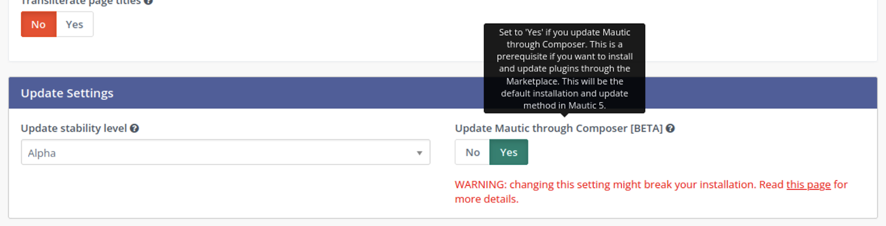
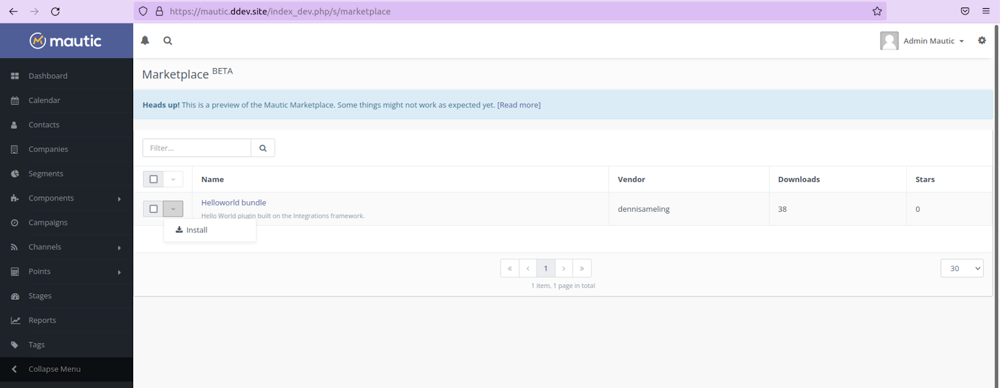
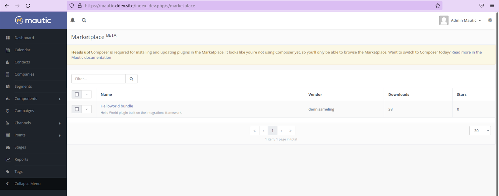
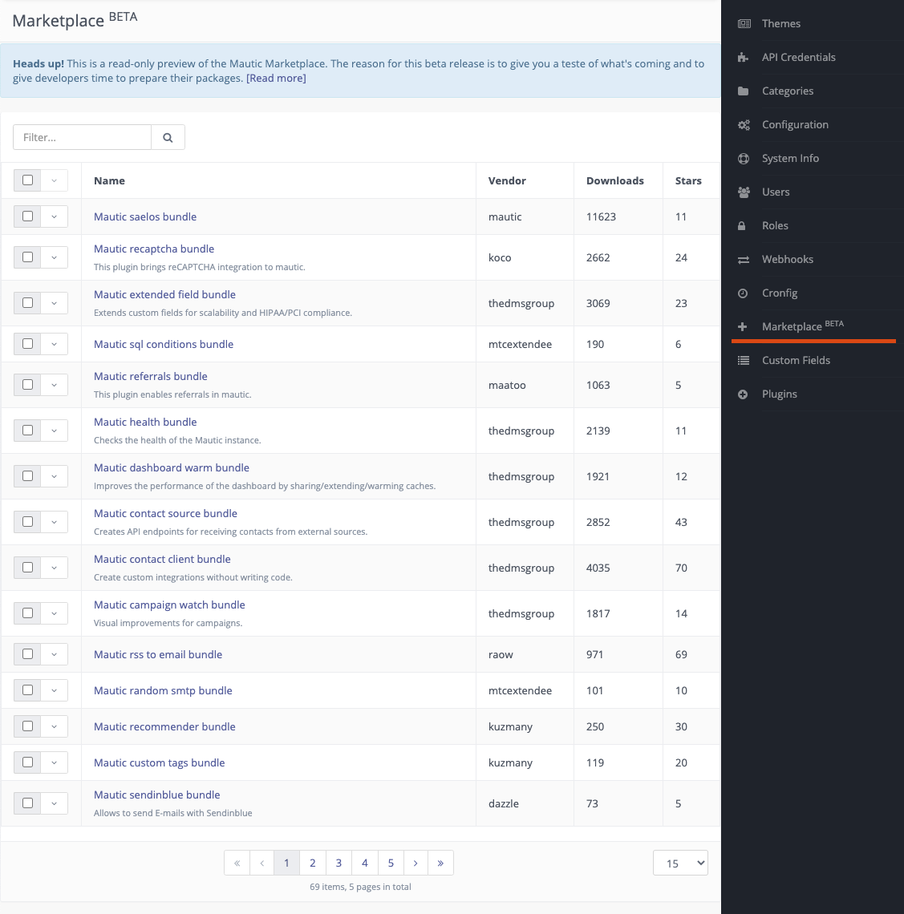

.. vale off

Mautic Marketplace
##################

.. vale on

.. warning:: 

    The current Marketplace version doesn't verify Mautic version compatibility of Plugins yet, as this requires a change in each existing Plugin.

    Please don't blindly manually install Plugins you see in the Mautic Marketplace, as they may not work with your version of Mautic. Always verify if they support your Mautic version before installing. Developers can refer to the :xref:`Marketplace` section in the Developer Documentation for how to make your Plugin compatible with the Mautic Marketplace.

.. vale off

Using the Mautic Marketplace
****************************

.. vale on

From Mautic 4.2, a setting in the Mautic Configuration specifies that the instance uses Composer, which allows the installation, update, and removal of Plugins in the Mautic Marketplace. This is a requirement due to the technology which underpins the Mautic Marketplace.

Once configured, you can search the Marketplace using the filter, and install Plugins by selecting the option from the dropdown.

If you haven't correctly set the Composer setting, Mautic displays a warning that the Mautic Marketplace is available in read-only mode, with a link which explains how to transition to a :doc:`Composer-managed</getting_started/switching_composer>` installation.

.. vale off 

List of Plugins
***************

.. vale on

The list of Plugins available in the Marketplace is accessible from your Mautic administration menu. Click the **cog icon** in the top right hand corner to display the menu.

The Marketplace lists Plugins, Themes, and Campaigns. The list view shows each package's type, the vendor who developed it, its downloads, and how many stars it has in :xref:`Packagist`. You can search for specific keywords. The Packagist API doesn't support sorting, so you can't sort the list by its columns.

* Click a package name to view details.

Filtering by package type
=========================

To list only one type of package, use the **Quick filters** popover:

#. Open **Quick filters** next to the search box.

#. Under **Type**, select **Plugin**, **Theme**, or **Campaign**.

#. Click **Apply selected**.

Mautic adds a type command, such as ``type:mautic-plugin``, to the search box and shows only packages of that type. Campaign packages use the ``type:mautic-resource`` command. You can type keywords alongside the type command to search within that type. Mautic applies one type at a time, so selecting a different type replaces the previous command.

To list every type again, select **All types** and click **Apply selected**, or click **Reset**.

Mautic keeps your search and type filter when you open a package and then return to the list, and when you move between pages of results.

Plugin detail page
******************

The detail page gives you enough information together with links to additional resources to decide whether you want to install the Plugin or not.

.. image:: images/marketplace-detail.png
  :width: 800
  :alt: Screenshot of marketplace detail

Overview
========

The **Overview** tab shows the package's description, formatted as the package author wrote it. If the author provides expected outcomes, an **Expected outcomes** panel describes what the package helps you achieve. Packages without a detailed description show their short description instead.

For Plugins and Themes, the **Overview** tab also shows the command to install the package from the command line. Campaign packages don't show this command.

Latest stable version
=====================

The **Details** tab shows the latest stable version. *From Mautic 4.2, this includes the currently installed - if any - version and the ability to upgrade.*

All Plugins should follow :xref:`semantic versioning` so you can see from the first glance whether it's a breaking change version, feature version or bug fix - patch - version. In short, it's more risky to install breaking change versions and less risky to install a bug fix version.

The license should be GPLv3 mostly as Mautic uses this license, and it's a viral license. This means anything using Mautic's code base should also use the same license.

Required packages are dependencies, listed with the version constraint each one requires. The bigger is the list of dependencies, the bigger the size of the Plugin. More dependencies also means more security risks and incompatibility issues with future upgrades.

When the package author provides them, the same table also shows:

* Package name
* Programming language
* Content languages
* Supported Mautic versions
* Industry
* Keywords
* Price
* Authors and their roles
* Support links, such as the issue tracker or documentation
* Funding links

The supported Mautic versions come from the package author, so verify them before you install a package.

Click the version number to open the release page for the latest stable version in a new window.

Maintainers
===========

In this section is a list of maintainers of the Plugin on Packagist. There may be more contributors in the GitHub repository. There is also a link to the Packagist detail page for the maintainer, where you can browse other PHP packages by the same maintainer.

GitHub information
==================

:xref:`github` is where many developers host their code. The majority of Mautic Plugins are available on GitHub. There are some stats available directly in this section, but you can find much more if you follow the link to the repository.

Packagist information
=====================

:xref:`Packagist` is a PHP package repository. It's not related specifically to the Mautic Community, but to the PHP community.

All the PHP packages listed in Packagist are installable by Composer which is a tool for dependency management used under the hood when you install a Mautic Plugin. The Packagist section shows download stats of Plugin installations in different time frames, the number of Packagist favorites, and how many other packages depend on or suggest the package.

Context menu
============
The context menu shows actions you can take.

* Close takes you to the list view

* Install installs the Plugin

* Issue tracker opens a new window with the issue tracker for the Plugin. It shows only if the Plugin has this information available. Use this option to search for issues with the Plugin and to report new issues to the maintainers.

Ratings and reviews
*******************

The Mautic Marketplace shows community ratings and reviews for Plugins. This helps you decide which Plugins to install. These community ratings and reviews reflect other people's opinions, not a Mautic-verified guarantee of version compatibility or security, so always verify that a Plugin supports your Mautic version before installing.

Viewing ratings
===============

Each Plugin in the list view shows its average Mautic Marketplace community rating, as a number rather than star icons, and its total review count. This community rating is separate from the Packagist stars shown in the same list, and gives you a quick sense of community feedback before viewing full details.

When you open a Plugin, the Reviews panel shows the average rating out of five and the number of reviews, then lists individual reviews from other community members. Each review has a 1 to 5 star rating, the review text, and the reviewer's username.

Submitting a review
===================

To submit a review for a Plugin, click the **Rate & Review** button on the Plugin's detail view. **Rate & Review** is a separate button, marked with a star icon. It isn't in the context menu. Clicking it opens that Plugin's own listing on the public Mautic Marketplace website at :xref:`Mautic Marketplace website` in a new browser tab, where you can sign in and leave your review.

.. note::

    The public Mautic Marketplace website manages reviews, not your Mautic instance. This lets the community share feedback across all Mautic installations.

Command line (CLI) command
**************************

The Marketplace has commands for those who prefer using the command line to the user interface, or for automation of processes.

.. vale off

List Plugins
============

.. vale on

``bin/console mautic:marketplace:list`` lists the first page of available Plugins like so:

.. code:: shell

  +-------------------------------------------------------+-----------+--------+
  | name                                                  | downloads | favers |
  +----------------------------------------------------+--------+-----+
  | mautic/mautic-saelos-bundle                           | 11623     | 11     |
  | koco/mautic-recaptcha-bundle                          | 2662      | 24     |
  |     This plugin brings reCAPTCHA integration to       |           |        |
  |     mautic.                                           |           |        |
  | thedmsgroup/mautic-extended-field-bundle              | 3069      | 25     |
  |     Extends custom fields for scalability and         |           |        |
  |     HIPAA/PCI compliance.                             |           |        |
  | mtcextendee/mautic-sql-conditions-bundle              | 190       | 6      |
  | maatoo/mautic-referrals-bundle                        | 1063      | 5      |
  |     This plugin enables referrals in mautic.          |           |        |
  | thedmsgroup/mautic-health-bundle                      | 2139      | 11     |
  |     Checks the health of the Mautic instance.         |           |        |
  | thedmsgroup/mautic-dashboard-warm-bundle              | 1921      | 12     |
  |     Improves the performance of the dashboard by      |           |        |
  |     sharing/extending/warming caches.                 |           |        |
  | thedmsgroup/mautic-contact-source-bundle              | 2852      | 43     |
  |     Creates API endpoints for receiving contacts from |           |        |
  |     external sources.                                 |           |        |
  | thedmsgroup/mautic-contact-client-bundle              | 4035      | 70     |
  |     Create custom integrations without writing code.  |           |        |
  | thedmsgroup/mautic-campaign-watch-bundle              | 1817      | 14     |
  |     Visual improvements for campaigns.                |           |        |
  | raow/mautic-rss-to-email-bundle                       | 971       | 69     |
  | mtcextendee/mautic-random-smtp-bundle                 | 101       | 10     |
  | kuzmany/mautic-recommender-bundle                     | 250       | 30     |
  | kuzmany/mautic-custom-tags-bundle                     | 119       | 20     |
  | dazzle/mautic-sendinblue-bundle                       | 73        | 5      |
  |     Allows to send E-mails with Sendinblue            |           |        |
  +-------------------------------------------------------+-----------+--------+
  Total packages: 69
  Execution time: 388 ms
    
There are options allowing you to filter or go to next pages. To display the full list, add ``--help`` after the command, as used in other Mautic commands.

.. code:: shell

  -p, --page[=PAGE]      Page number [default: 1]
  -l, --limit[=LIMIT]    Packages per page [default: 15]
  -f, --filter[=FILTER]  Filter the packages [default: ""]
  -h, --help             Display this help message

Example usage how to search for a ``Captcha`` Plugin: ``bin/console mautic:marketplace:list --filter=captcha``

Planned features
================

Watch out for more features in future releases including:

* Automatic Plugin updates - a configuration that allows you to set globally whether you want to automatically upgrade Plugins and also have the possibility of configuring this at the Plugin level. Automatic upgrades make sense only for bug fix releases. Other releases are too risky and manual updates required. :xref:`API reference`

* List security advisories :xref:`API reference`,

* Notifications about new versions and security vulnerabilities that identified,

* Support also Theme installations and updates.

.. vale off

How to get your Plugin listed on the Mautic Marketplace
*******************************************************

.. vale on

Please review the resources on the :xref:`Marketplace` section in the Developer Documentation for more information.