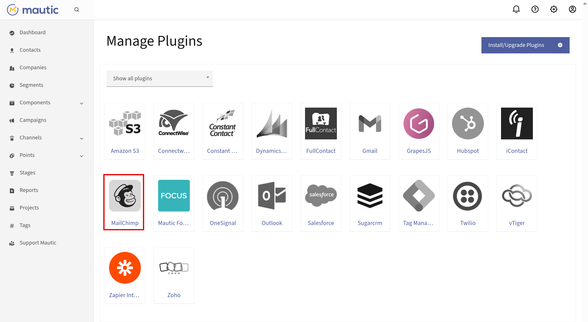
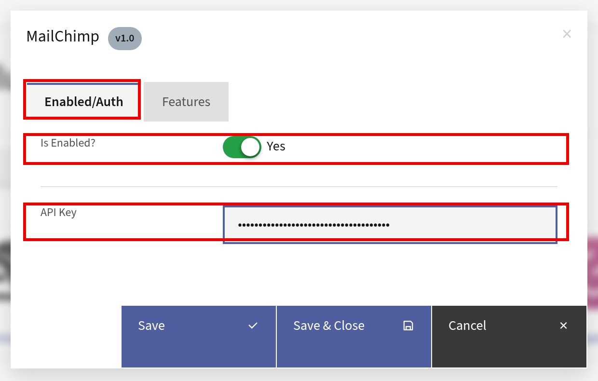
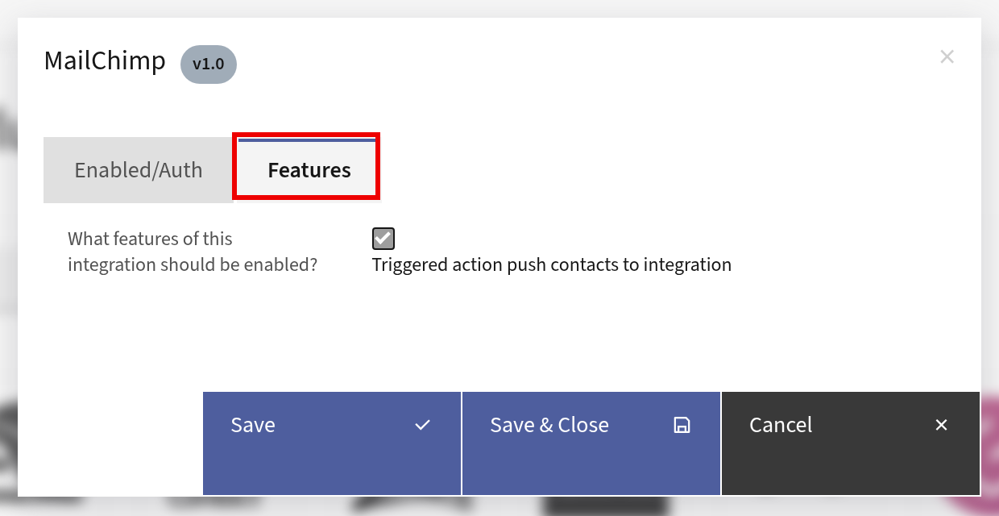
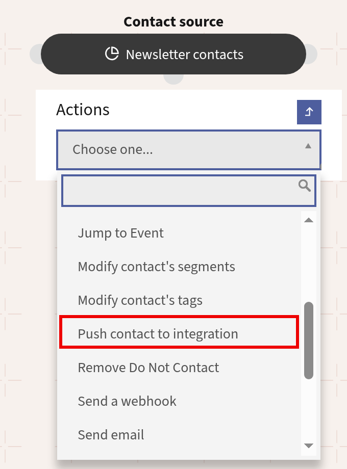
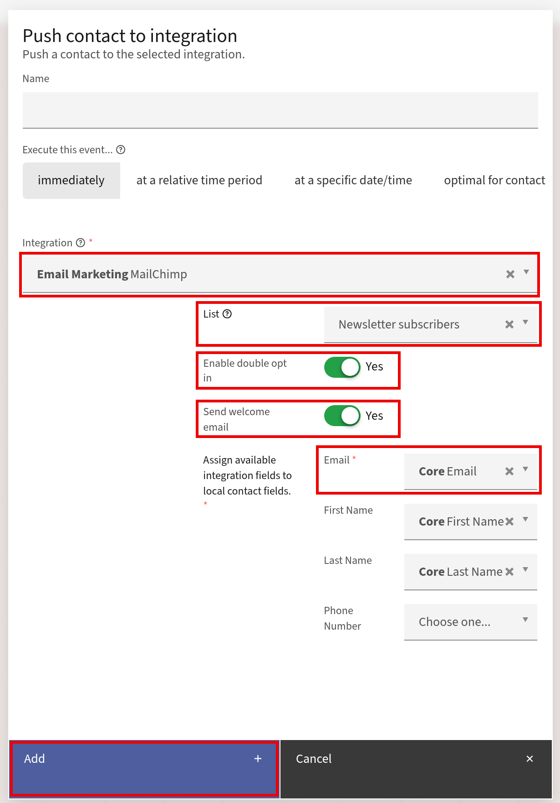

MailChimp
#########

This Plugin adds Contacts to MailChimp lists when a Campaign, a Form, or a Point Trigger runs an action that pushes Contacts to MailChimp.

Authorize
*********

Get MailChimp API key
=====================

#. Create a MailChimp account.
#. Go to **Account** > **Extras** > **API Keys** and create a new one.
#. Copy the created API Key.

  .. image:: images/plugins-mailchimp-create-api-key-1-and-2.png
   :alt: Screenshot of MailChimp dashboard with arrows pointing at the Extras tab and the API Keys section
   :align: center

  .. image:: images/plugins-mailchimp-create-api-key-3a.png
     :alt: Screenshot of MailChimp dashboard with an arrow pointing at the Create API Key button
     :align: center

  .. image:: images/plugins-mailchimp-create-api-key-3b-and-3c.png
     :alt: Screenshot of the Name New API Key section with arrows pointing at the test and Generate Key button
     :align: center

.. vale off

Configure the Plugin
********************

#. Go to **Settings** > **Plugins** and select **MailChimp**.
#. On the **Enabled/Auth** tab, set **Is Enabled?** to **Yes**.
#. Paste the API key in the **API Key** field.
#. On the **Features** tab, select **Triggered action push contacts to integration**.
#. Select **Save & Close**.

.. vale on

Mautic asks for the API key only when you enable the Plugin. If you connected MailChimp through the OAuth authorization of an earlier Mautic version, Mautic keeps using that connection, and you can save the settings without an API key.

.. vale off

Push Contacts to MailChimp
**************************

.. vale on

Each push action has its own MailChimp list and field mapping, so different Campaigns, Forms, and Point Triggers can add Contacts to different lists.

.. vale off

#. Add a **Push contact to integration** action to a Campaign, a Form, or a Point Trigger.
#. Select **MailChimp** as the Integration.
#. In **List**, select the MailChimp list to add the Contacts to.
#. Set **Enable double opt in** and **Send welcome email** to **Yes** or **No**.
#. For each MailChimp field, select the Mautic field that provides its value. You must map a field to **Email**.
#. Select **Add**.

.. vale on

If you don't have a list in MailChimp yet, create one in MailChimp before you add the action. The field mapping shows the merge fields of the list you select, and it reloads when you select another list. Besides Contact fields, you can map a MailChimp field to these values:

.. vale off

* **Contact ID**
* **Contact's timeline link**
* **Do not contact by email** - whether the Contact accepts Emails from Mautic

.. vale on

The list options control what MailChimp sends to the Contact:

.. vale off

* **Enable double opt in** - MailChimp sends a confirmation Email, and the Contact must confirm before joining the list. Until then, MailChimp lists the Contact as pending.
* **Send welcome email** - MailChimp sends its welcome Email to the Contact.

.. vale on

If the Contact has no value in the field mapped to **Email**, or MailChimp rejects the Contact, the action fails and shows the reason. In a Campaign, the reason appears on the failed event.
