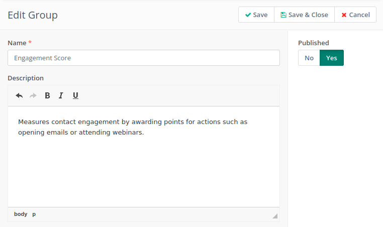
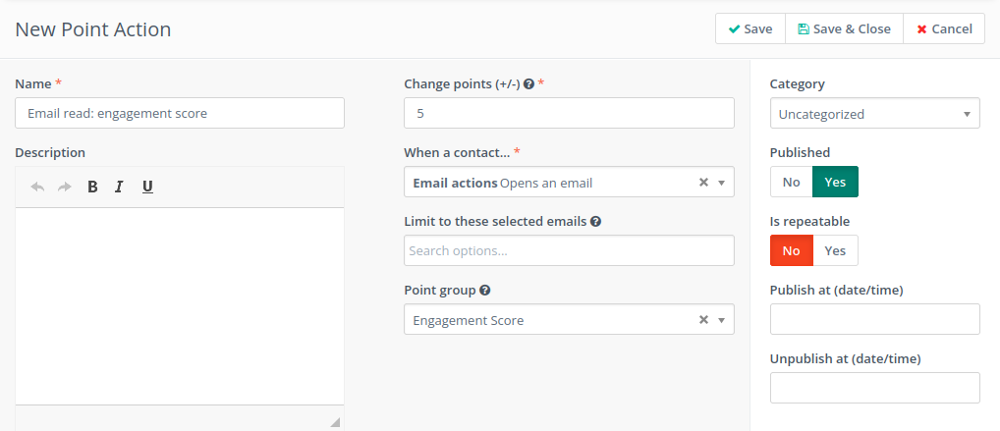
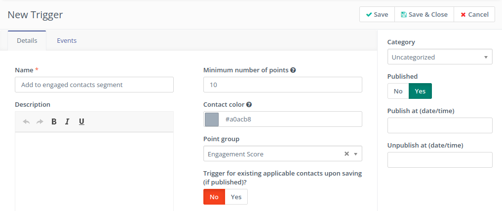
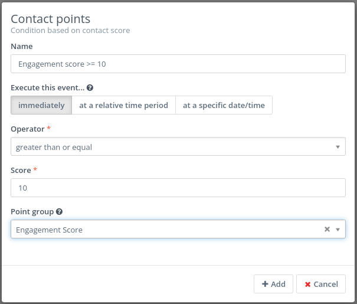
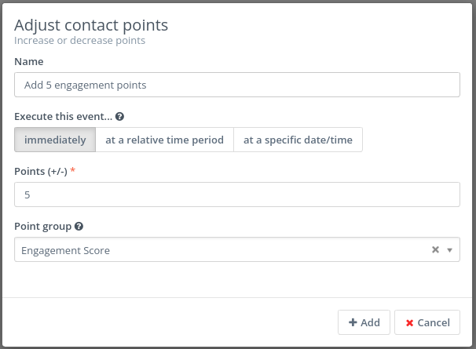
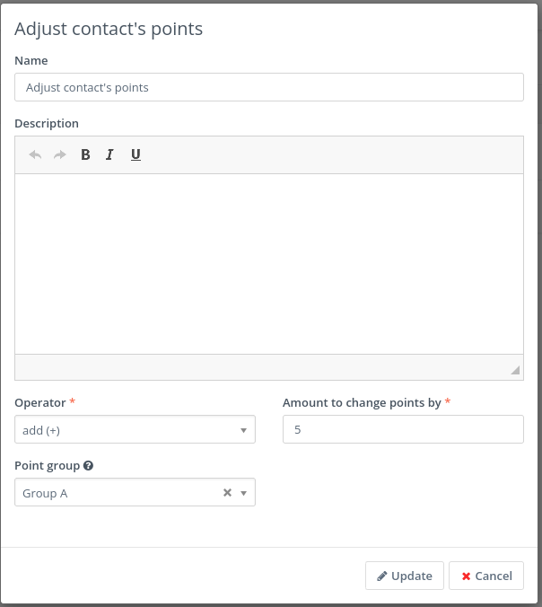
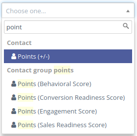
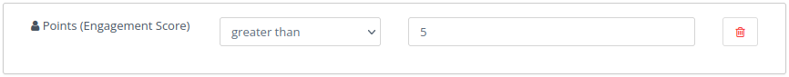
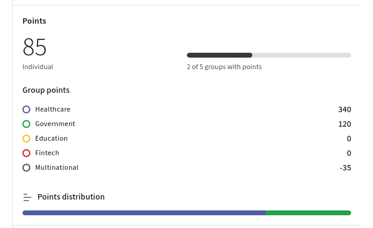
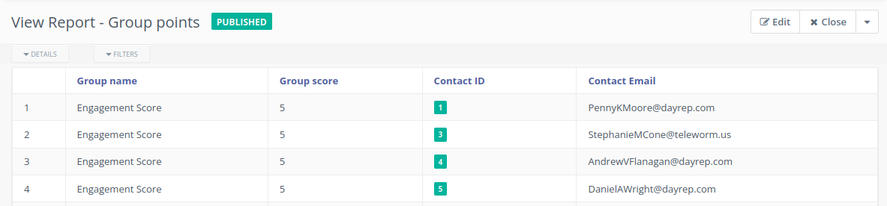

.. vale off

Point Groups
#############

.. vale on

Point Groups is a feature that allows Users to categorize the score of their Contacts. By setting up Point Groups, Users can assign a specific number of Points to each action taken by a Contact, such as opening an Email, visiting a Landing Page, or downloading an Asset.

.. vale off

Managing Point Groups
======================

.. vale on

To access the currently defined Point Groups in Mautic, navigate to the Points Menu and click the "Manage Groups" link. To create a new Group, simply click the "New" button.

Enter a name and a description for the Group and click the "Save & Close" button to create the Group.

.. warning::

   Deleting a Point Group permanently deletes the Contact scores in that group. You can't undo this action.

.. vale off

Point Groups usage
===================

Using Point actions
-------------------
You can change Contact's Points within a Points Group by using Points Actions.

Using Point triggers
--------------------
You can use Point triggers based on Point Groups to automatically trigger specific events within the system.

Campaign condition
------------------
You can use a condition based on Group Contact score in a Campaign.

Campaign action
---------------
You can use a Campaign action to increase or decrease the Group Contact score.

Form action
---------------
You can use a Form action to increase or decrease the Group Contact score.

Segment filters
---------------
Each Point Group adds a new filter for configuring the Segment.

Contact details
---------------
The **Points** card on a Contact's detail page shows the Contact's Points and their score in every Point Group.

The card contains these parts:

* The large number, captioned 'Individual', is the Contact's own Points. Mautic tracks it separately from the Point Group scores, so it doesn't have to equal the sum of the group scores.
* The meter next to the total shows how many Point Groups have a positive score, such as '2 of 5 groups with points'.
* **Group points** lists every Point Group from the highest score to the lowest, including groups where the Contact has 0 Points.
* **Points distribution** is a bar that shows how the positive group scores split across Point Groups. Hover over a segment to see the group's name and score. Groups with a score of 0 or less don't appear in the bar.

.. vale off

Group Report
-------------

.. vale on

You can generate a Report that contains information about Contact Point Groups.

Webhooks
--------
Changing the Contact Group Points doesn't trigger the Contact Points Changed Event Webhook